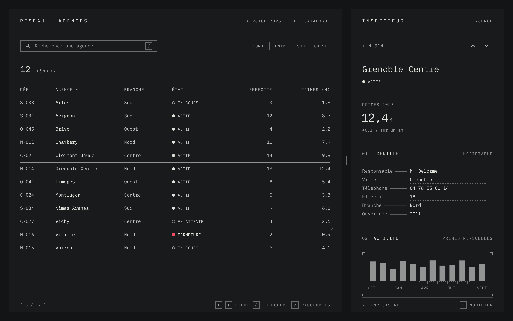
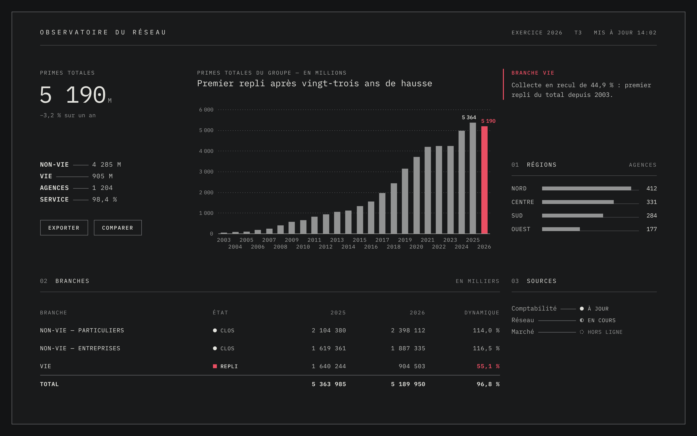
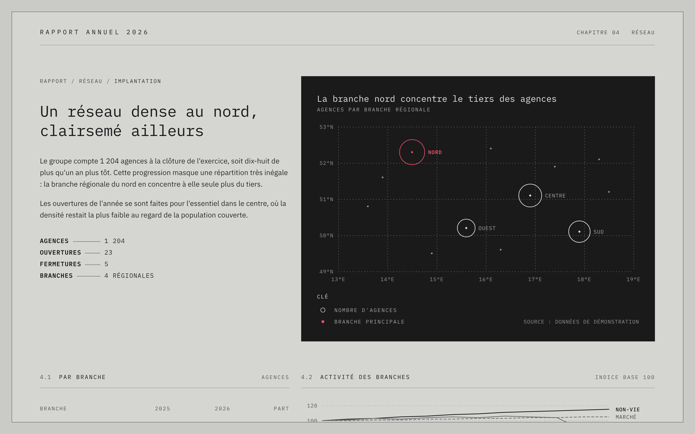
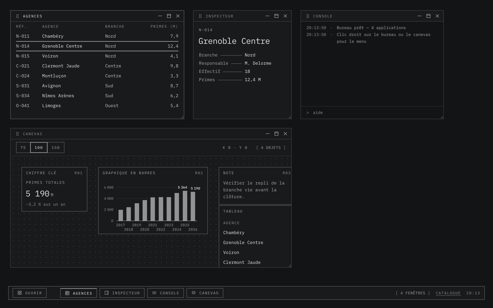

# MONO

Design system monochrome, sobre et technique, pour les interfaces de données,
les outils et les rapports. Treize gris, une seule couleur, des règles de
composition — et un catalogue pour les réemployer.



> MONO traite l'écran comme une page imprimée : une encre, un papier, des filets,
> beaucoup de vide — et une seule couleur, gardée pour ce qui ne doit pas être manqué.

## Philosophie

Le système est né de cinq images dont aucune n'est une interface : un dos de
pochette de disque, une étiquette technique sérigraphiée et trois pages d'un
rapport annuel. Quand une décision hésite, la question est toujours la même :
*cela aurait-il sa place sur ces pages ?*

Neuf convictions en découlent. Le détail, les budgets par vue et l'ordre
d'arbitrage sont dans [`docs/philosophie.md`](docs/philosophie.md).

1. **L'écran est une page.** Un format, des marges, un contour d'un pixel, un
   haut à gauche. On compose des vues, pas des assemblages de tuiles.
2. **La retenue fait la hiérarchie.** Le clair, le gras, la grande taille et la
   couleur ne valent que parce qu'ils sont rares : un point focal, un chiffre
   héros, trois corps de texte.
3. **Le gris est une matière.** Treize tons, de `#131415` à `#E9E9E5`. Ni noir
   ni blanc purs. Deux thèmes symétriques : `encre` et `papier`.
4. **La couleur est un événement.** Une seule teinte, le signal, sous 1 % de
   l'écran, pour un seul fait par vue, toujours doublée d'une forme ou d'un mot.
5. **Le vide travaille.** Un tiers de la vue reste libre. C'est l'espace qui
   forme les groupes et donne l'ordre de lecture.
6. **La structure se trace, elle ne s'emboîte pas.** Un filet avant un cadre, et
   un filet se mérite : on essaie d'abord sans. Rayon 0, pas d'ombre, pas de
   dégradé.
7. **Une forme, un sens.** Filet plein : structure. Tireté : relation.
   Pointillé : repère. Hachures : hors d'atteinte. Aucune forme ne décore.
8. **La sélection s'efface devant son résultat.** Un élément sélectionné ne
   change que de contour. Le clair va à ce que l'action a produit.
9. **Lisible avant d'être beau.** 11 px au moins, contrastes WCAG contrôlés par
   script. Quand le style et la lisibilité s'opposent, la lisibilité gagne.

### Une couleur, et rarement

Sur un écran entier, le signal ne désigne qu'un fait : ici, la branche en repli.
Tout le reste se distingue par le ton, la graisse et le trait.



### Encre et papier

Les deux thèmes partagent les mêmes rôles. Un bloc inversé, un seul par vue,
porte la masse sombre sur le papier.



### La page, ses onglets, son inspecteur

Toute page a un contour et repose sur un plan de travail uni. L'écran ne défile
jamais : c'est le contenu de la page qui défile. La navigation s'écrit en mots.
Le détail d'un élément va dans l'inspecteur, séparé par l'espace seul, jamais
dans une modale. La ligne sélectionnée ne change que de contour.


### La modale : une petite page sur une page hachurée

Les hachures n'apparaissent qu'ici. En dessin technique, une zone hachurée est
une zone exclue : c'est l'état de la page tant que la modale est ouverte. La
modale elle-même n'a ni bandeau, ni croix, ni filet intérieur.


### Les images sont encrées

Un dessin au trait du système entre tel quel. Une photo est ramenée au gris et
fondue dans le ton de la page ; tramée si elle pèse encore. Au survol, le filet
d'une fiche cliquable se termine en flèche : le survol annonce le clic.


### Connexion, bureau

| | |
|---|---|
|  |  |

## En bref

- **Monospace**, capitales espacées, filets d'un pixel, angles droits.
- **Un jeu d'icônes maison** de 50 dessins sur une grille de 16 px.
- **Aucune dépendance** pour le système, aucune étape de construction. Polices
  embarquées. Seul l'exemple « bureau » embarque une bibliothèque (interact.js)
  pour déplacer, redimensionner et aimanter les fenêtres.
- **Un journal des décisions** : chaque règle, sa raison et ce qui a été écarté,
  dans [`docs/decisions.md`](docs/decisions.md).

## Voir le catalogue

```bash
npm run serve
```

Puis ouvrir <http://localhost:8080/catalogue/>. Le catalogue est statique : tout
serveur de fichiers convient (GitHub Pages compris, depuis la racine du dépôt).

## Utiliser le système

```html
<html lang="fr" data-theme="encre">
  <link rel="stylesheet" href="src/mono.css">
```

`src/mono.css` importe les tokens, la base, les composants et les marques de
données. Un squelette d'écran complet se trouve dans `docs/composition.md`.

## Organisation

```
src/
  tokens.css        tons bruts, rôles sémantiques par thème, échelles
  base.css          reset, texte (.t-), mise en page (.l-), utilitaires (.u-)
  components.css    composants (.c-)
  viz.css           marques de données pour SVG (.v-)
  signs.css         signes graphiques (.g-) : repères d'angle, règle, crochets…
  icons.json/.css   jeu d'icônes maison, 16 px, en masques CSS (.c-icon .i-nom)
  fonts.css, fonts/ IBM Plex Mono et Sans (SIL OFL 1.1)
  mono.css          point d'entrée
docs/               les règles
  captures/         les captures d'écran de ce fichier
  decisions.md      journal des décisions : ce qui a été choisi, écarté, et pourquoi
  philosophie.md    le pourquoi : convictions, budgets, arbitrages, tests d'écart
  principes.md      les 8 principes et la liste de contrôle d'un écran
  fondations.md     tons, rôles, signal, typographie, espace, filets
  composition.md    masses tonales, équilibre, méthode
  composants.md     index des composants et de leurs variantes
  dataviz.md        règles et classes de visualisation
catalogue/          le catalogue navigable (démonstrations + code)
  exemples/         sept écrans : tableau de bord, rapport, collection + inspecteur,
                    connexion, bureau à fenêtres, et deux gabarits de shell à
                    copier : application.html (arborescente) et
                    application-modules.html (modules séparés)
  assets/vendor/    interact.js (MIT), pour la seule version bureau
scripts/
  contrast.mjs      contrôle des contrastes des tokens
  build-search-index.mjs  index de la recherche du catalogue
  build-icons.mjs   feuille d'icônes à partir de icons.json
  tonal-audit.mjs   mesure des masses tonales d'un écran
reference/
  maquette-v1.html  la maquette d'origine, conservée pour mémoire
```

## Recherche du catalogue

Le champ en haut de chaque page (touche `/`) cherche dans toutes les rubriques :
règles, composants, tokens, classes. Plusieurs mots sont tous requis ;
`"expression exacte"`, `-exclure`, `.c-classe`, `--token` et les codes de règle
(`S2`, `C4`) sont reconnus ; les filtres par rubrique et par type se cumulent.
`?q=…` dans l'adresse préremplit la recherche.

L'index est un fichier généré. Après toute modification d'une page du catalogue
ou de `src/tokens.css` :

```bash
npm run build:search
```

## Contrôles

```bash
npm run check:contrast
```

```bash
node scripts/tonal-audit.mjs catalogue/exemples/tableau-de-bord.html
```

```bash
npm run check:search
```

Le premier vérifie chaque paire texte/fond des deux thèmes et refuse tout noir ou
blanc pur. Le second capture un écran et chiffre la part de fond, de gris moyens,
d'éclat et de signal, ainsi que le vide ; il demande Playwright
(`npm i -D playwright && npx playwright install chromium`). Le troisième échoue si
l'index de recherche n'est plus à jour.

## Écarts par rapport à la maquette d'origine

Les références visuelles priment sur la maquette. Ce qui a changé :

| Maquette v1 | MONO | Raison |
|---|---|---|
| Textes de 8 à 10 px | Plancher à 11 px, 13 px par défaut | Lisibilité |
| Sans-serif pour les textes courants | Monospace partout ; sans-serif pour la prose longue seulement | Les références sont entièrement en monospace |
| Aucune couleur | Un signal rouge, sous 1 % | Les références l'emploient pour désigner la donnée clé |
| Dégradés dans les aires et les espacements | Aplats uniquement | Références plates |
| Interrupteur arrondi | Angles droits partout | Cohérence des formes |
| Barres en quatre gris alternés | Un gris moyen, valeurs en clair | Un ton par sens ; le chiffre porte le clair |
| Carte du monde en points | Graticule pointillé à coordonnées | Référence cartographique |
| Thème sombre seul | Thèmes encre et papier, blocs inversés | Les références jouent du panneau sombre sur fond clair |
| Grain fixe sur toute la page | Utilitaire optionnel `.u-grain` | Ne doit pas nuire au texte |
| Filets en `rgba` | Tons opaques nommés | Contrastes mesurables |
